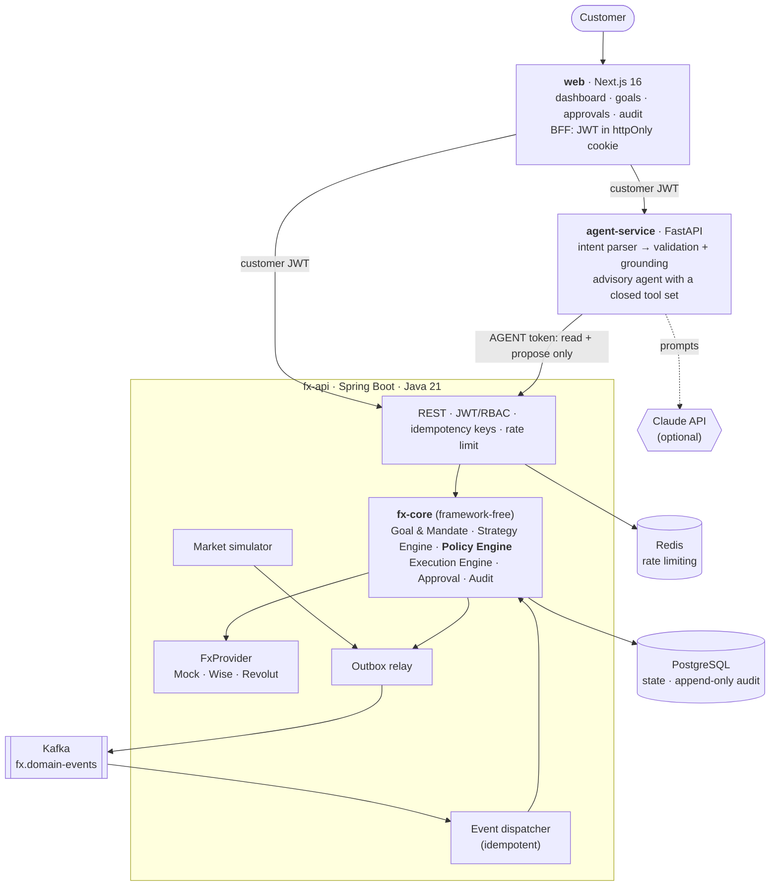
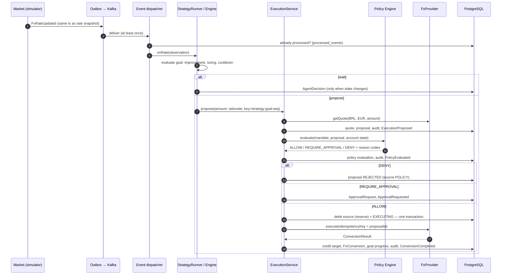
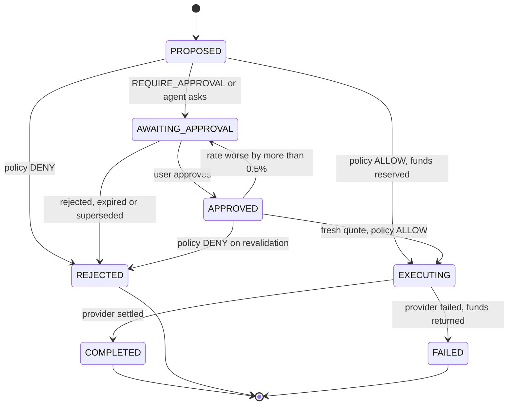
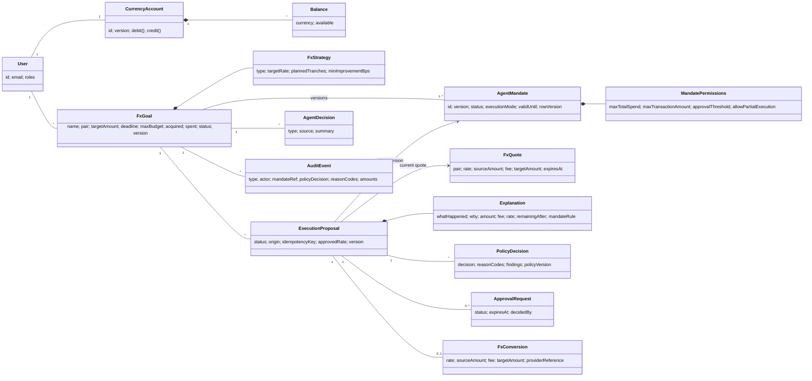

# Architecture

## 1. System architecture



Deployment is two application services plus PostgreSQL, Redis and a broker. The financial modules are packages
inside `fx-api`, not separate services: they share one transactional database, which is what makes the
guarantees below cheap and strong.

### Module layout

```
fx-core (no Spring, no I/O)
  money/        Currency, Money, CurrencyPair, ExchangeRate
  account/      User, CurrencyAccount, Balance
  goal/         FxGoal, FxStrategy, GoalStatus, StrategyType
  mandate/      AgentMandate (versioned), MandatePermissions, ExecutionMode
  fx/           FxQuote, FxProvider (port), MockFxProvider, ConversionRequest/Result, FxConversion
  market/       MarketSimulator, RateBook (port), RateObservation
  execution/    ExecutionProposal, ExecutionStatus
  approval/     ApprovalRequest
  policy/       PolicyEngine, DeterministicPolicyEngine, Policy (versioned rule set), ReasonCode
  strategy/     StrategyEngine, StrategySignal
  agent/        AgentDecision, Explanation
  audit/        AuditEvent
  event/        DomainEvent (sealed)
  port/         Repositories, EventPublisher, Transactions, Metrics
  application/  GoalService, ExecutionService, StrategyRunner   ← use cases
fx-app (Spring adapters)
  persistence/ (JdbcClient)  events/ (outbox, brokers, dispatcher)  web/  security/  market/  provider/
  observability/  scheduling/
```

The core is tested in isolation (112 tests, including the full lifecycle against in-memory adapters that emulate
the database constraints). The Spring module is tested against real PostgreSQL and Kafka with Testcontainers.

## 2. Execution sequence



## 3. Approval flow



Approval never bypasses policy: after the human approves, the platform fetches a **fresh quote**, re-runs the
full policy (balance, limits, deadline, mandate status) and only then executes. An approval pins the rate the
human saw; if the new rate is worse by more than 0.5%, the human is asked again.

## 4. Domain model



## 5. Guarantees and where they live

| Guarantee | Mechanism |
|---|---|
| A proposal executes at most once | `fx_conversions.proposal_id UNIQUE`; provider called with `idempotencyKey = proposalId`; `EXECUTING` state checked before settling |
| No overlapping proposals for a goal | partial unique index on `execution_proposals(goal_id)` for open statuses |
| One mandate version in force | partial unique index on `agent_mandates(goal_id) WHERE status = 'ACTIVE'` |
| Mandate terms never change | trigger rejects UPDATE of terms and DELETE; changes create version N+1 |
| Audit, quotes, conversions, policy evaluations are facts | triggers reject UPDATE/DELETE (and TRUNCATE on audit) |
| No lost or phantom events | transactional outbox; relay with `FOR UPDATE SKIP LOCKED` |
| Duplicate deliveries are harmless | `processed_events` + idempotent handlers (`strategy:<goal>:<sequence>` keys) |
| Concurrent writes don't clobber | optimistic locking (`version`) on every mutable aggregate, incl. the account |
| Funds can't be double-spent | ALLOW decision and source debit happen in the same transaction as the policy check |
| Crash between reservation and settlement | `recoverExecutions` sweeper re-drives `EXECUTING` proposals with the same idempotency key |

## 6. Event model

`FxRateUpdated · GoalCreated · GoalActivated · MarketConditionMatched · ExecutionProposed · PolicyEvaluated ·
ApprovalRequested · ApprovalGranted · ApprovalRejected · ConversionStarted · ConversionCompleted ·
ConversionFailed · GoalCompleted` — a sealed Java hierarchy (`DomainEvent`), serialised in an envelope
(`eventId, type, occurredAt, key, correlationId, payload`). Consumers resolve `type` only against the sealed
hierarchy, so a message cannot instantiate arbitrary classes. The partition key is the goal id (the pair for
market events), preserving per-goal ordering.

The broker is behind `EventBroker`: Kafka (default), in-memory (tests, single process) and a Kinesis placeholder
that fails fast until configured.

## 7. Observability

- **Structured logs** (ECS JSON in fx-api, JSON in agent-service) with `correlationId`; the id travels
  browser → BFF → agent-service → fx-api → outbox → consumer, and is stored on every audit event.
- **Tracing**: Micrometer Tracing with the OpenTelemetry bridge; OTLP export enabled by the `otel` profile.
- **Metrics** on `/actuator/prometheus`: `agent_decisions_total`, `policy_denials_total`,
  `approval_requests_total`, `fx_executions_total`, `fx_execution_failures_total`, `goal_completion_ratio`
  (plus `policy_decisions_total{decision}` and the JVM/HTTP defaults).
- **Health**: `/actuator/health/liveness`, `/actuator/health/readiness` (fx-api), `/health` (agent-service).

## 8. Deployment

`docker compose up --build` runs everything locally. `infra/terraform` contains the AWS structure: ECS Fargate
services in private subnets behind an ALB, RDS PostgreSQL, ElastiCache Redis, MSK Serverless, Secrets Manager.
See `infra/terraform/README.md` for the settings that differ from local (MSK IAM auth, Redis TLS).
