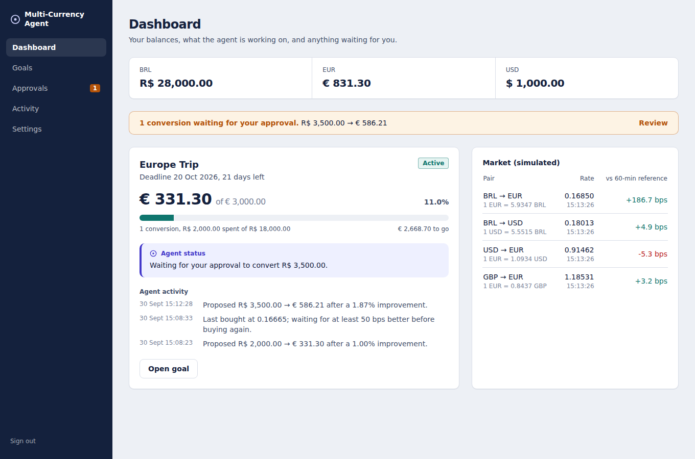

# Agentic FX

> **An agentic orchestration layer for multi-currency accounts that transforms financial intent into
> policy-controlled FX execution.**



## Problem

People and companies holding several currencies rarely need "a conversion". They need an outcome:
*€5,000 for a trip by 20 October, without spending more than R$32,000*. Today they either convert everything at
once (and take whatever the rate is that day) or babysit rate alerts:

```
IF EUR/BRL reaches X  THEN convert Y
```

Alerts know nothing about the goal, the deadline, the budget already spent or what the customer is comfortable
approving. And handing an AI agent "access to my money" is not acceptable either: language models are not
deterministic and can be manipulated.

## Solution

The customer states the goal in their own words. The platform turns it into a **mandate** — a versioned,
explicitly activated statement of exactly what the agent may do — and lets an agent work the goal over time:

```
GOAL         Acquire €5,000 before 20 October
CONSTRAINTS  At most R$32,000 · at most R$5,000 per transaction · approval above R$3,000
AGENT        Monitor → Plan → Propose → Validate → Execute → Adapt
```

The central flow: **Intent → Strategy → Policy → Monitoring → Approval → Execution → Audit**.

## Why agentic FX

- **Goal-aware.** Size and timing depend on how far the goal is, how much budget is left and how close the
  deadline is — not on a single trigger.
- **Explainable.** Every recommendation says what happened, why, how much, the fee, the rate, what remains, and
  which mandate rule allows it.
- **Safe by construction.** The system separates **intelligence** from **authority**. The agent reasons,
  recommends and proposes. A deterministic policy engine — which no model output can override — decides what may
  execute, and the database itself enforces the invariants that matter (no double execution, append-only audit,
  immutable mandate terms).

| Intelligence (may be wrong, may be manipulated) | Authority (deterministic, audited) |
|---|---|
| Parse intent into a **draft** mandate | Customer activates the mandate explicitly |
| Detect market conditions, size tranches | Policy Engine: ALLOW / REQUIRE_APPROVAL / DENY |
| Propose conversions, explain them | Customer approves; quote revalidated; policy re-run |
| Ask for approval even when not required | Execution Engine reserves funds, executes idempotently |

## Architecture

```
            ┌───────────── web (Next.js) ─────────────┐   JWT in httpOnly cookie, BFF proxy
            │                                         │
            ▼                                         ▼
     agent-service (FastAPI) ── AGENT token ──► fx-api (Spring Boot, Java 21)
     intent parsing · LLM agent                 Goal · Mandate · Policy · Strategy · Execution
     (Claude or deterministic)                  Approval · Market · Providers · Audit
                                                   │        │         │
                                               PostgreSQL  Redis   Kafka (outbox → events)
```

Two application services, not a microservice zoo: `fx-api` holds every financial module as a package, around a
framework-free core (`fx-core`) that contains all the rules and is tested without Spring. Details and diagrams:
[ARCHITECTURE.md](ARCHITECTURE.md).

| Path | What |
|---|---|
| `fx-api/fx-core` | Domain model, Policy Engine, Strategy Engine, market simulator, MockFxProvider, use cases behind ports |
| `fx-api/fx-app` | Spring Boot adapters: REST, JWT/RBAC, JDBC + Flyway, outbox relay, Kafka, schedulers, metrics |
| `agent-service` | Natural language → validated intent; advisory agent with a closed tool set |
| `web` | Dashboard, conversational goal creation, approvals, audit timeline |
| `infra/terraform` | AWS deployment skeleton (ECS Fargate, RDS, ElastiCache, MSK Serverless) |
| `scripts` | Demo scripts (PowerShell and bash) |

## How to run

Requirements: Docker Desktop (Compose v2).

```bash
docker compose up --build
```

Open **http://localhost:3000** and sign in as `demo@agentic.fx` / `demo-password`. The stack starts in the demo
state: BRL 30,000 · EUR 500 · USD 1,000 and an active goal (acquire €3,000 by 20 October).

| Service | URL |
|---|---|
| Web | http://localhost:3000 |
| fx-api (Swagger UI) | http://localhost:8080/swagger-ui.html |
| fx-api metrics | http://localhost:8080/actuator/prometheus |
| agent-service (OpenAPI) | http://localhost:8000/docs |

Optional: copy `.env.example` to `.env` and set `ANTHROPIC_API_KEY` to use Claude for intent parsing and the
advisory agent. Without it, deterministic parsers are used and everything works.

### Tests

```powershell
cd fx-api; mvn verify          # core unit tests + Testcontainers integration tests (needs Docker)
cd agent-service; python -m pytest
cd web; npm ci; npm run build  # strict TypeScript + production build
```

## Demo

Scripted, in a second terminal while the stack runs:

```powershell
.\scripts\demo.ps1            # Windows
./scripts/demo.sh             # macOS / Linux (curl + jq)
```

Or in the UI: **Settings → Demo market controls**. The full walkthrough is in [DEMO.md](DEMO.md).

1. The rate improves 1.15% → the agent proposes **R$2,000** → policy **ALLOW** → executes automatically.
2. The rate improves 1.85% → the agent proposes **R$3,500** → policy **REQUIRE_APPROVAL** (above R$2,500).
3. You approve → the quote is **revalidated** → policy re-runs → executes → dashboard and audit update.

## Security model

- The LLM has **no money-moving capability**: no execute or approve tool exists, and the registry refuses one.
- The agent uses a **delegated, 10-minute, AGENT-only token**: read tools and proposal creation, nothing else.
- Every LLM output is **schema-validated and grounded** (amounts the customer never wrote are discarded) and only
  ever produces a **draft** the customer must activate.
- The **Policy Engine is deterministic and versioned**; proposal origin (strategy or LLM) and free text cannot
  change its decision.
- **Database-enforced** invariants: one conversion per proposal, one open proposal and one active mandate per
  goal, append-only audit and quotes, immutable mandate terms.
- **Idempotency keys** on financial operations, **optimistic locking** everywhere, quotes expire in 30 s and are
  revalidated after approval.

Full threat model: [SECURITY.md](SECURITY.md). Agent internals: [AGENT_DESIGN.md](AGENT_DESIGN.md).
Endpoints: [API.md](API.md).

## Future integrations

- **Real liquidity providers**: `WiseFxProvider` and `RevolutFxProvider` document the API mapping; implementing
  them means filling two methods. The rest of the platform is provider-agnostic.
- **Real market data** replacing the simulator behind the `RateBook` port.
- **Payment rails and cards**: spend the acquired currency (e.g. AP2-style mandates for agent-initiated payments).
- **Notifications**: push/email consumers of `ApprovalRequested` (the event already exists).
- **Identity**: replace password login with OIDC; keep the AGENT delegation as an OAuth token exchange.
- **More strategies**: volatility-aware sizing, VWAP-like pacing — new `StrategyType`s, still under policy.
